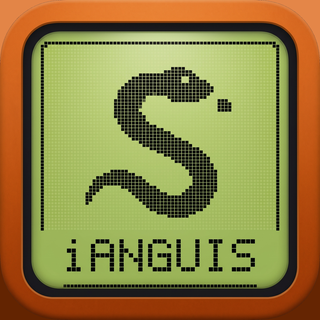
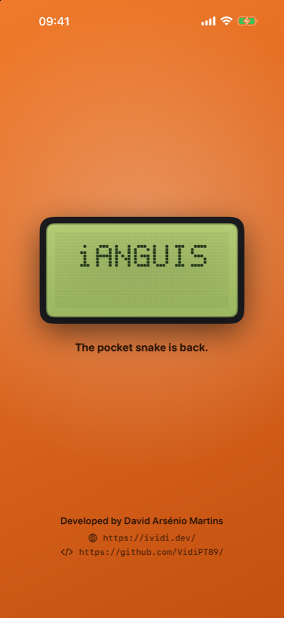
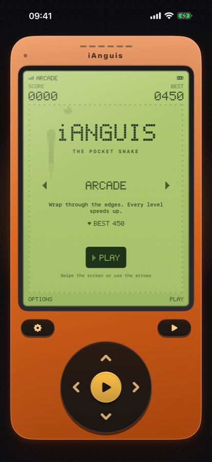
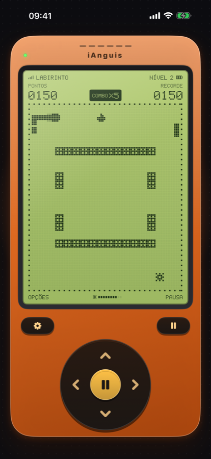
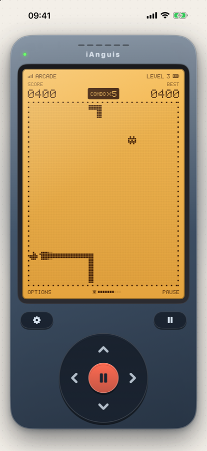
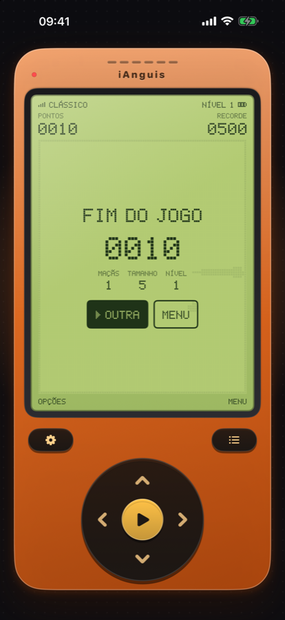

<p align="center"></p>

# 🐍 iAnguis

> The pocket Snake you remember from the first mobile phones, rebuilt natively for iOS with a dot-matrix LCD, swappable covers and that "just one more round" feeling.

[](https://github.com/VidiPT89/iAnguis/issues) [](https://github.com/VidiPT89/iAnguis/issues) [](https://github.com/VidiPT89/iAnguis/actions/workflows/ios.yml)

<p align="center">
  
  
  
  
</p>

## ✨ Features

- ✅ True dot-matrix LCD: every cell is drawn as 5×5 dots, with ghost pixels, glass glare and the slow fade of an old monochrome panel
- ✅ Smooth movement that slides dot by dot, or classic cell-by-cell steps if you prefer the original feel
- ✅ A snake with character: a three-dot body that follows every corner, an eye that blinks, a mouth that opens next to food and crossed eyes on a crash
- ✅ Four modes: Classic (solid walls), Arcade (wrap through the edges), Maze (walls in your way) and Zen (a steady pace), each with its own record
- ✅ Combo system up to ×5 for quick catches, so every apple is a small decision
- ✅ A bonus critter every five apples, worth more the sooner you catch it, with a countdown bar on screen and a sad beep if it escapes
- ✅ A "TOP!" flash and jingle the moment you beat your record, then a fanfare on the result screen
- ✅ Speed rises every five apples, with a level-up jingle
- ✅ Attract mode: a demo snake plays the selected mode behind the menu
- ✅ Eight swappable console covers, two free and six earned by playing (apples eaten, rounds, best score, length and bonus critters)
- ✅ Four screen backlights: classic green, amber, ice blue and grey
- ✅ Pocket console design: speaker grille, status LED, soft keys with on-screen labels and a round four-way key that tilts towards the side you press
- ✅ Touch-down controls, buffered turns and continuous swipes, so zig-zags need only one gesture
- ✅ Death blink and screen jolt, flying pixels and floating "+20" scores, all on the LCD
- ✅ Piezo-style square-wave sounds synthesised at launch (no audio files) and haptic feedback, both optional
- ✅ Animated launch introduction with developer credits, then straight into the menu
- ✅ Lifetime statistics: rounds, apples, bonus critters, longest snake and best score per mode
- ✅ Runtime language switch: Português (PT-PT) and English, independent of the system language
- ✅ Dark mode, Light mode and System mode
- ✅ Colour identity taken from [ividi.dev](https://ividi.dev/): burnt orange, amber and near-black
- ✅ Automatic pause when leaving the app or opening Settings
- ✅ Up to 120 Hz on ProMotion displays, VoiceOver labels and Reduce Motion support
- ✅ Offline play, no accounts, no ads and no analytics

## 🛠️ Tech Stack

| Category     | Technology                                      |
| ------------ | ----------------------------------------------- |
| Language     | Swift                                           |
| UI           | SwiftUI and Canvas                              |
| Rendering    | Custom dot-matrix raster driven by CADisplayLink |
| Architecture | Observation + UI-free game engine               |
| Audio        | AVAudioEngine (synthesised, no audio files)     |
| Haptics      | UIKit feedback generators                       |
| Storage      | UserDefaults, on device                         |
| Project      | XcodeGen                                        |
| Min. iOS     | 17.0, iPhone and iPad                           |

## 🚀 Quick Start

### Prerequisites

- macOS with Xcode 16+
- iOS 17+ simulator or device
- [XcodeGen](https://github.com/yonaskolb/XcodeGen) only if you change `project.yml` (`brew install xcodegen`)

### Installation

```bash
git clone https://github.com/VidiPT89/iAnguis.git
cd iAnguis
open iAnguis.xcodeproj
```

Select the `iAnguis` scheme and run with `⌘R`. For a physical device, choose your signing team under Signing & Capabilities.

## 📖 Usage

Pick a mode with the arrows on the LCD, the left and right keys or a sideways swipe, then press **Play** (or the centre key). Eat apples to grow; catch them quickly to build the combo. When the critter appears, chase it before its bar runs out. Avoid your own tail, the walls in Classic and the bricks in Maze.

Swipe anywhere on the screen or use the round key to turn. The centre key pauses and resumes. The right soft key pauses during play, ends the round from the pause screen and returns to the menu after a game over. The left soft key opens Settings, where you can change language, appearance, cover, backlight, movement style, sound and haptics, and see your statistics.

<p align="center">
  
</p>

## 🧪 Testing

Run the engine checks on macOS:

```bash
./scripts/test.sh
```

467 checks cover turning and input buffering, pause and resume, growth and food placement, combos, bonus critters and their expiry, mid-round records, abandoned rounds, wall, maze and body collisions, wraparound, levels and speed, the demo autopilot on every mode, cover unlocks, stored statistics and records, and the result timing. A seeded full-board game verifies victory, and clock checks compare 20, 30, 60, 120 and 144 fps.

Build the app:

```bash
xcodebuild -project iAnguis.xcodeproj -scheme iAnguis \
  -destination 'generic/platform=iOS' CODE_SIGNING_ALLOWED=NO build
```

Sound and haptics should be checked on a physical iPhone.

## 📄 License

Distributed under the MIT License. See [LICENSE](LICENSE) for details.

## 👨‍💻 Author

**David Arsénio Martins**

🌐 Website: [ividi.dev](https://ividi.dev/)
🐙 GitHub: [@VidiPT89](https://github.com/VidiPT89/)

## 🤝 Contributing

Issues and feature requests are welcome on the [issues page](https://github.com/VidiPT89/iAnguis/issues).

---

<p align="center">Developed by <a href="https://ividi.dev/">David Arsénio Martins</a></p>
<p align="center">If you like this project, consider giving it a ⭐</p>
